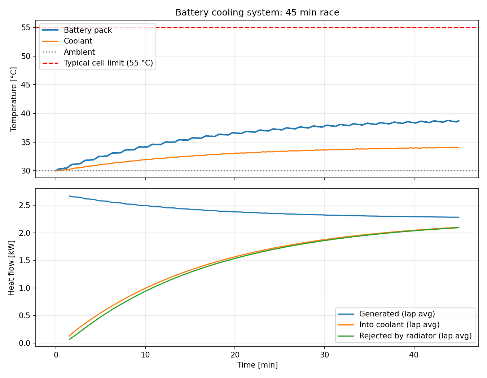
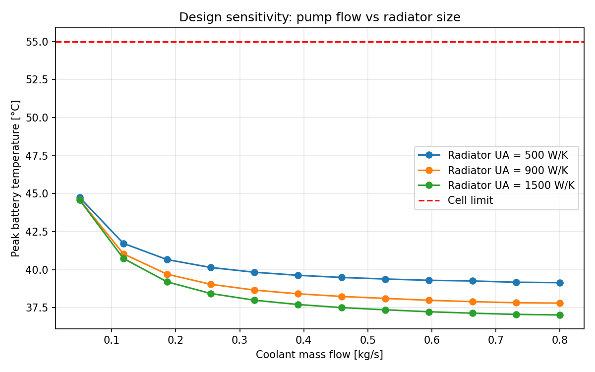

# EV Battery Cooling Model
Lumped-parameter thermal model of an EV race car battery cooling system,
written in Python.

**System:** battery pack → cold plate → water-glycol loop → radiator → ambient air

## Method
- Two coupled transient energy balances, for the battery pack and the coolant loop
- Heat generation from Joule heating (I²R), with temperature-dependent
  pack resistance (Arrhenius-type)
- Cold plate modelled using ε-NTU with an isothermal hot side
- Radiator modelled using ε-NTU crossflow (both fluids unmixed)
- Lap-based power profile over a 45 min race
- Solved with `scipy.integrate.solve_ivp`

Parameters are illustrative values for a ~40 kWh, 800 V race pack.

## Results

The pack peaks at about 41 °C, well below the typical 55 °C cell limit.
Heat rejected by the radiator rises towards the heat generated as the
system approaches steady state.

Sensitivity study of pump flow rate against radiator performance.

## Validation
- Energy balance closes to 0.004% error
- Checked against hand calculations

## Run it
pip install numpy scipy matplotlib
python battery_cooling_model.py
